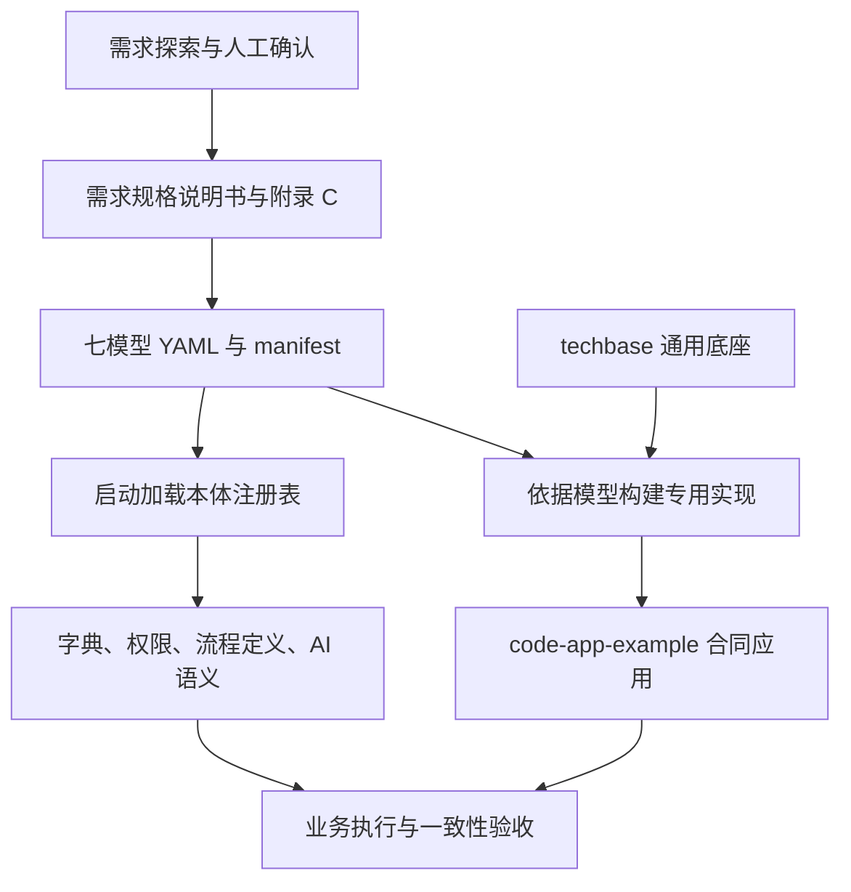
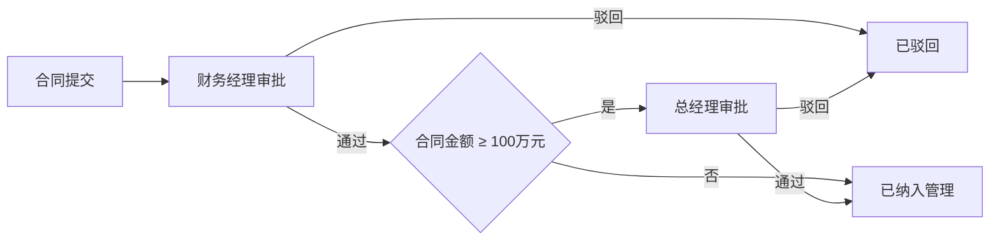
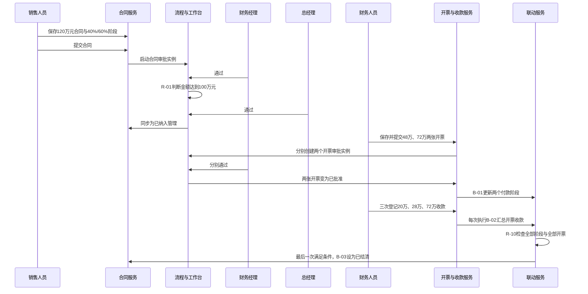

好的，老板。

# 本体驱动开发全流程分析：从需求、七模型到合同业务代码

> 核验日期：2026 年 10 月 15 日。源码基线：`9c498fa`。
>
> 对照范围：`reference-example`、`techbase`、`code-app-example`，以及仓库中的建模规范与开发指导书。
>
> 本文区分三类证据：**规范要求**表示文档约定；**源码事实**表示当前代码如何工作；**运行验证**表示已在隔离临时数据库中执行并通过断言。代码摘录均为节选，局部结构简化处另有说明。

阅读导航：

- [三个目录与差异总表](#2-三个目录业务基线技术能力与落地结果)
- [需求、建模与应用构建流程](#3-开发阶段一需求探索与规格基线)
- [七模型逐项对照](#5-七模型逐项对照规格yaml底座与应用代码)
- [120 万元合同完整案例](#6-完整案例120-万元合同从登记到结清)
- [AI 如何使用本体](#7-ai-助手怎样使用本体)
- [模型修改的生效边界](#8-修改模型之后哪些变化会真正生效)
- [规格、模型与代码的已确认偏差](#9-已确认偏差问题发生在哪一层)
- [验证结果](#10-验证结果与可持续维护方式)
- [完整案例重放脚本](#附录-a可重放的完整合同案例脚本)
- [源码阅读索引](#附录-b源码定位索引)

## 1. 核心认识与阅读方式

这套实现以七模型 YAML 固定业务语义，再依据模型扩展技术底座。它同时包含开发期的代码构建约束、启动期的元数据注册和运行期的流程与规则解释。

理解“驱动”需要逐项回答四个问题：

1. 哪一条业务规格提出了要求？
2. 哪一个模型元素表达了要求，并引用哪些其他元素？
3. 数据库、服务、接口、页面分别怎样落实它？
4. 运行时究竟读取模型执行，还是执行依据模型编写的专用代码？

例如，M6 的审批图确实由通用引擎解释；M1 的表结构保存在独立 DDL；M2 的联动主要是显式函数调用；M7 的报表主要是专用 SQL。它们共同形成一个“模型约束构建＋部分模型运行时解释”的应用。

建议先读第 2～4 节理解开发过程，再按第 5 节逐模型查证，最后用第 6 节完整合同案例串联。第 8～10 节说明修改生效边界、已发现偏差和验证范围，附录提供可重放的案例脚本。



## 2. 三个目录：业务基线、技术能力与落地结果

### 2.1 目录职责

| 目录 | 保存的内容 | 在开发过程中的职责 |
|---|---|---|
| `reference-example` | 合同需求规格、七模型、界面原型及调用链展示 | 说明业务和模型应该怎样表达 |
| `techbase` | 认证、系统管理、流程引擎、工作台、注册表及客户申请示例 | 提供可复制、可扩展的技术骨架 |
| `code-app-example` | 合同、开票、收款、审批、报表、主数据与 AI 助手 | 展示基于合同模型构建的应用结果 |

入口文件：[合同需求规格](<../reference-example/合同管理需求规格说明书-V9.md#L1> "第 1 行")、[技术底座说明](<../techbase/README.md#L1> "第 1 行")、[完整应用说明](<../code-app-example/README.md#L1> "第 1 行")、[本体业务开发指导书](<../references/本体模型业务功能开发指导书.md#L1> "第 1 行")。

底座里的“客户”是带审批的申请示例，实际表为 `customer_application`；合同应用里的“客户”是被合同引用的主数据，实际表为 `customer`。分析时应按业务职责识别对象，不能仅凭名称相同就认为对象语义不变。见[底座对象模型](<../techbase/models/m1-object-model.yaml#L7> "第 7 行")、[底座客户申请表](<../techbase/backend/schema.sql#L158> "第 158 行")、[应用业务表](<../code-app-example/backend/schema.sql#L170> "第 170 行")。

### 2.2 文件差异规模

按当前 `rg --files` 可见文件逐字节比较两个应用目录，结果如下。统计包含样例数据库，不包含被忽略的依赖与构建产物。

| 项目 | 数量 | 说明 |
|---|---:|---|
| 底座文件 | 82 | 对比基线 |
| 应用文件 | 123 | 业务扩展结果 |
| 原样复用 | 47 | 注册表、流程引擎、大量系统与流程管理代码 |
| 内容修改 | 30 | DDL、种子、业务回调、模型、路由、布局等 |
| 新增 | 46 | 合同领域服务、页面、报表、规则、AI 等 |
| 未沿用 | 5 | 客户申请示例的服务、接口及页面文件 |

尤其值得注意：两边的 `ontology/registry.py`、`engine/flow_engine.py`、`services/flow_service.py` 内容完全相同。新业务主要靠替换模型、初始化定义、增加服务和页面接入通用能力。

### 2.3 七模型差异总表

| 模型 | 底座规模 | 参考模型规模 | 应用与参考模型的实际差异 |
|---|---|---|---|
| M1 对象 | 1 个聚合根 | 8 个聚合根、2 个子实体 | 仅补全产品类型和客户类型字典选项 |
| M2 行为 | 5 个行为 | 25 个行为 | 文件完全相同 |
| M3 规则 | 无独立模型文件 | 13 条规则 | 文件完全相同 |
| M5 主体 | 4 个角色 | 6 个角色 | 新增管理员，应用共 7 个角色 |
| M6 流程 | 1 条流程 | 4 条流程 | 从描述性活动表改写为 `nodeGraph` |
| M7 查询报表 | 无独立模型文件 | 5 个查询报表 | 文件完全相同 |
| MU 界面 | 2 个屏幕 | 15 个屏幕 | 菜单改接通用工作台，加入流程与系统管理；屏幕数仍为 15 |

加载清单见[底座 manifest](<../techbase/models/manifest.json#L1> "第 1 行")、[参考 manifest](<../reference-example/manifest.json#L1> "第 1 行")、[应用 manifest](<../code-app-example/models/manifest.json#L1> "第 1 行")。模型数量表示声明规模，不代表每一项都已完整执行。

## 3. 开发阶段一：需求探索与规格基线

### 3.1 先确认业务事实

[仓库开发技能](<../SKILL.md#L1> "第 1 行")将过程分为需求探索、本体建模、应用构建三个阶段。需求探索又依次确认：总体理解、业务对象、功能与规则、跨对象联动、协同与审批流程、查询报表、角色权限，以及可选的界面原型。

这些确认用于固定企业专属事实。例如本合同业务已经确认：

- 合同及付款阶段校验通过后才能提交。
- 合同先由财务经理审批；金额大于等于 100 万元时增加总经理审批。
- 两级审批严格串行。
- 开票由财务经理审批，通过后才能收款。
- 错误收款通过冲销修正，保留历史。
- 全部付款阶段足额开票，且全部有效开票收齐后，合同才能结清。

对应[审批规格](<../reference-example/合同管理需求规格说明书-V9.md#L880> "第 880 行")、[规则规格](<../reference-example/合同管理需求规格说明书-V9.md#L508> "第 508 行")、[联动规格](<../reference-example/合同管理需求规格说明书-V9.md#L758> "第 758 行")。规格中的人工确认门禁是开发方法要求；本文分析现有产物，不重新执行需求确认过程。

### 3.2 附录 C 是模型的确定性输入

[需求附录 C](<../reference-example/合同管理需求规格说明书-V9.md#L1149> "第 1149 行")将正文整理成七模型输入。稳定编号提供了跨阶段追踪关系：

| 规格元素 | 模型表达 | 代码落地点 |
|---|---|---|
| 合同对象及付款阶段 | M1 `AGG-CONTRACT-001`、`PaymentStage` | 合同主从表、表单、保存校验 |
| `FUNC-02` 提交合同 | M2 `Contract_Submit` | 合同提交 API 与服务 |
| `R-01` 审批层级判断 | M3 `RULE-CONTRACT-APPROVAL-LEVEL` | M6 网关调用规则求值 |
| `ROLE-03` 财务经理 | M5 `ROLE-FINANCE-MANAGER` | 角色数据、任务办理人 |
| `PROC-APP-01` 合同审批 | M6 `FLOW-CONTRACT-APPROVAL-001` | 流程定义、实例、任务 |
| `REP-03 / Q-03` 执行分析 | M7 `REP-CONTRACT-EXECUTION` ↔ M2 `Contract_QueryExecutionAnalysis` | 报表查询服务与页面 |
| 合同维护及提交按钮 | MU `frmContractMaintain` → `Contract_Submit` | React 页面、按钮、API 调用 |

正文用业务语言说明要求，附录 C 用稳定模型元素固定边界。建模阶段据此结构化表达，避免重新解释已经确认的业务。

## 4. 开发阶段二与三：建模、扩展和运行

### 4.1 七模型怎样相互关联

| 模型 | 回答的问题 | 主要引用 |
|---|---|---|
| M1 | 有哪些对象、字段、约束和状态？ | 其他对象、字典 |
| M2 | 对对象允许执行哪些行为？ | M1 对象、M3 规则、M5 权限、M7 查询；下游 M2 行为 |
| M3 | 什么条件允许，如何计算或判断？ | M1 的只读业务事实 |
| M5 | 谁能执行行为，能访问哪些数据？ | M2 行为、角色、主体 |
| M6 | 多人、多步骤业务怎样推进？ | M2 行为、M3 规则、M5 角色、其他流程 |
| M7 | 如何查询、聚合和展示业务事实？ | M1 对象、唯一 M2 查询行为 |
| MU | 用户从哪里进入并触发行为？ | M1 字段、M2 行为及相关流程和查询 |

模型编号保留历史体系；当前版本使用 M1、M2、M3、M5、M6、M7、MU。模型关系与约束见[建模规范](<../references/ontology_modeling_framework_v9.md#L38> "第 38 行")。

推荐建模顺序是：M1 → M5 角色 → M3 → M2 → M7 → M5 权限 → M6 → MU。由于查询与行为存在双向绑定，完成后仍需统一校验所有引用，不能只依赖编写顺序。

### 4.2 应用构建的十个步骤

以下按[开发指导书的十步流水线](<../references/本体模型业务功能开发指导书.md#L87> "第 87 行")展开：

| 步骤 | 输入 | 主要产物 | 应检查的结果 |
|---|---|---|---|
| 1. 编写模型 | 需求规格与附录 C | 七份 YAML | 业务边界和稳定 ID 完整 |
| 2. 注册模型 | YAML、manifest | 运行时注册表 | 模型可读、引用可追溯 |
| 3. 构建数据库 | M1 | DDL、表与字段 | 聚合主从关系、审计字段、逻辑删除 |
| 4. 注册字典 | M1 字典 | 元数据接口与下拉选项 | 代码值和显示标签一致 |
| 5. 实现行为规则 | M2、M3、M1 内置约束 | 服务、API、联动 | 前置条件、规则、结果和事务 |
| 6. 配置权限 | M5 | 角色权限数据与鉴权接入 | 功能权限、数据范围真实执行 |
| 7. 配置流程 | M6 | 可执行图、定义与任务 | 节点角色、分支、结果回调 |
| 8. 构建页面 | MU、M1、M2 | 菜单、路由、表单、按钮 | 控件与动作可追溯 |
| 9. 接入 AI | 注册表、实际能力 | 提示词、工具、流式对话 | 语义正确、执行能力明确 |
| 10. 联调验收 | 全部模型与实现 | 可运行应用与验证证据 | 正向、异常和模型一致性 |

具体生成动作发生在应用构建阶段；仅凭当前源码，不能判断某段代码究竟由人工还是 AI 编写。

### 4.3 启动时实际发生什么

[应用入口](<../code-app-example/backend/app.py#L12> "第 12 行")依次完成数据库路径配置、本体加载、执行 DDL、初始化数据、注册业务接口。

```text
create_app()
  → registry.load_ontology()
      → 读取 manifest.model_files
      → 按 model_type 注册对象、行为、规则、角色、流程和屏幕
  → _init_db()
      → 执行 schema.sql
      → ensure_seed()
          → 首次初始化角色、权限、菜单、用户、主数据
          → 补充尚不存在的流程定义
  → 注册 Flask 业务接口
```

[注册表](<../code-app-example/backend/ontology/registry.py#L33> "第 33 行")主要建立模型 ID 到模型内容的索引。注册一个模型元素，表示程序可以找到它；后续是否自动执行其中语义，取决于对应执行器或业务代码。

## 5. 七模型逐项对照：规格、YAML、底座与应用代码

### 5.1 M1 对象模型：对象边界、字段与不变量

#### 5.1.1 对照文件与变化

| 层次 | 文件与内容 |
|---|---|
| 规格 | [对象章节](<../reference-example/合同管理需求规格说明书-V9.md#L535> "第 535 行")、[M1 输入基线](<../reference-example/合同管理需求规格说明书-V9.md#L1149> "第 1149 行")：八个聚合根、两个从属明细及其关联 |
| 参考 YAML | [参考 M1](<../reference-example/m1-object-model.yaml#L114> "第 114 行")：对象、属性、字典、关联、`refRules`、`invariants`、生命周期 |
| 底座 | [底座 M1](<../techbase/models/m1-object-model.yaml#L7> "第 7 行")与[底座 DDL](<../techbase/backend/schema.sql#L158> "第 158 行")：客户申请示例 |
| 应用 YAML | [应用 M1](<../code-app-example/models/m1-object-model.yaml#L114> "第 114 行")：保留合同模型，补充两个字典的具体选项 |
| 应用代码 | [业务 DDL](<../code-app-example/backend/schema.sql#L170> "第 170 行")、[合同校验与保存](<../code-app-example/backend/services/contract_service.py#L11> "第 11 行")、[合同页面](<../code-app-example/frontend/src/pages/contract/ContractMaintain.tsx#L17> "第 17 行") |

参考模型中的产品类型、客户类型都是空选项；应用分别补入 `SOFTWARE/HARDWARE/SERVICE` 和 `PERSONAL/ENTERPRISE/GOVERNMENT`。M1 的其余内容与参考文件一致。

#### 5.1.2 对象怎样映射到表

| M1 对象或子实体 | SQL 表 | 业务含义 |
|---|---|---|
| `Product` | `product` | 产品主数据 |
| `Customer` | `customer` | 客户主数据 |
| `Department` | `department` | 部门主数据 |
| `Employee` | `employee` | 人员及部门归属 |
| `Contract` | `contract` | 合同聚合根 |
| `PaymentStage` | `contract_stage` | 合同付款阶段，从属于合同 |
| `Invoice` | `invoice` | 开票聚合根 |
| `InvoiceStageAllocation` | `invoice_allocation` | 开票在付款阶段上的分摊 |
| `Receipt` | `receipt` | 收款事实 |
| `ApprovalRecord` | `approval_record` | 审批历史 |

物理表名存在领域适配，例如 `PaymentStage` 对应 `contract_stage`，并非所有名称都只经过驼峰转下划线。新增业务表还使用 `created_by/created_at/updated_by/updated_at/flag` 五个公共字段，服务通过 `flag` 实现有效数据过滤和逻辑删除。

#### 5.1.3 字段与约束怎样落实

M1 的合同金额字段节选：

```yaml
- name: totalAmount
  label: 合同总金额（含税）
  type: Money
  required: true
  refRules:
    - name: 合同总金额必须为正数
      description: 合同总金额必须大于 0
      expression: "value > 0"
```

对应[合同校验](<../code-app-example/backend/services/contract_service.py#L11> "第 11 行")：

```python
total = float(data.get("total_amount") or 0)
if total <= 0:
    raise ValueError("合同总金额必须大于 0")
```

约束分为三层：REF 表达单字段要求，INV 表达聚合内部不变量，R 表达独立跨对象规则。例子分别是“金额大于零”“付款比例合计 100%”“责任人部门等于合同部门”。前两类放在 M1，后一类进入 M3。

付款阶段保存时，服务先获取合同主键，再为各阶段写入 `contract_id`，根据 `total_amount × pay_ratio / 100` 计算阶段金额。主表和从表共用一个保存事务，见[阶段保存](<../code-app-example/backend/services/contract_service.py#L118> "第 118 行")及[合同草稿保存](<../code-app-example/backend/services/contract_service.py#L134> "第 134 行")。

**驱动边界：** 当前表结构执行独立 `schema.sql`；属性校验、聚合校验和状态门禁主要是专用服务分支。M1 注册本身不会自动改表、生成所有表单或统一执行全部约束。字典加载及元数据读取则属于直接使用模型的能力。

### 5.2 M2 行为模型：前置条件、结果与同步联动

#### 5.2.1 对照文件与变化

| 层次 | 文件与内容 |
|---|---|
| 规格 | [功能详述](<../reference-example/合同管理需求规格说明书-V9.md#L325> "第 325 行")、[行为基线](<../reference-example/合同管理需求规格说明书-V9.md#L1168> "第 1168 行")：人工功能、查询、审批、自动行为 |
| 参考与应用 YAML | [参考 M2](<../reference-example/m2-behavior-model.yaml#L1> "第 1 行")、[应用 M2](<../code-app-example/models/m2-behavior-model.yaml#L1> "第 1 行")：文件完全相同，共 25 个行为 |
| 底座 | [底座 M2](<../techbase/models/m2-behavior-model.yaml#L1> "第 1 行")、[客户服务](<../techbase/backend/services/customer_service.py#L1> "第 1 行")：5 个客户示例行为及实现 |
| 应用代码 | [合同服务](<../code-app-example/backend/services/contract_service.py#L134> "第 134 行")、[开票服务](<../code-app-example/backend/services/invoice_service.py#L9> "第 9 行")、[收款服务](<../code-app-example/backend/services/receipt_service.py#L44> "第 44 行")、[联动服务](<../code-app-example/backend/services/sync_service.py#L20> "第 20 行") |

25 个行为由合同 3 个、开票 3 个、收款 2 个、作废归档 2 个、主数据维护 4 个、查询 5 个、审批 3 个和自动行为 3 个组成。

#### 5.2.2 收款行为的完整语义

```yaml
- id: Receipt_Record
  name: 录入合同收款
  ownerEntity: AGG-RECEIPT-001
  behaviorType: COMMAND
  triggerType: USER_ACTION
  appliedRules:
    - RULE-INVOICE-REMAIN-RECEIPT-QUOTA
    - RULE-RECEIPT-CONTRACT-CONSISTENT
  requiredPermissions:
    - PERM-RECEIPT-RECORD
  syncTriggers:
    - behaviorRef: Invoice_UpdateReceiptStatus
      description: 收款登记后同步更新开票收款状态
```

上例节选自[收款行为](<../code-app-example/models/m2-behavior-model.yaml#L127> "第 127 行")，省略了前置及后置条件。模型分别规定：主要修改哪个对象、谁触发、调用哪些判断、需要何种授权、成功后继续调用什么。

| 模型字段 | 当前落实方式 |
|---|---|
| `preconditions` | 服务入口检查当前状态和业务数据 |
| `appliedRules` | 显式调用领域规则函数 |
| `postconditions` | INSERT、UPDATE、状态写回 |
| `requiredPermissions` | 接口中显式接入权限检查；现有声明仍有不一致 |
| `syncTriggers` | 显式调用下游函数 |
| `queryReportRef` | 与 M7 定义保持双向引用 |

#### 5.2.3 从按钮到服务

```text
收款页面 → receiptApi.record → POST /api/receipt
  → 检查 PERM-RECEIPT-RECORD
  → receipt_service.record
  → 检查已批准开票、金额、额度与合同一致性
  → 写入收款并调用下游联动
```

见[前端收款接口](<../code-app-example/frontend/src/api/receipt.ts#L25> "第 25 行")、[后端收款入口](<../code-app-example/backend/api/receipt.py#L25> "第 25 行")。

服务在写入收款后直接调用：

```python
sync_service.update_invoice_receipt_status(inv["id"], conn)
```

这行代码实现了模型声明的联动关系。当前没有一个通用 M2 执行器逐项遍历全部行为声明；行为之间也不要求与 Python 函数严格一对一。例如合同提交与重新提交在模型中分开，在代码中共用接受“草稿/已驳回”的 `submit()`。

**驱动边界：** 模型约束实现意图与追溯关系，业务服务负责执行。修改 M2 后需要同时核对对应 API、服务和页面。

### 5.3 M3 规则模型：独立判断与实际执行方式

#### 5.3.1 对照文件与变化

| 层次 | 文件与内容 |
|---|---|
| 规格 | [R-01～R-13](<../reference-example/合同管理需求规格说明书-V9.md#L508> "第 508 行")及[规则输入基线](<../reference-example/合同管理需求规格说明书-V9.md#L1191> "第 1191 行") |
| 参考与应用 YAML | [参考 M3](<../reference-example/m3-rule-model.yaml#L1> "第 1 行")、[应用 M3](<../code-app-example/models/m3-rule-model.yaml#L7> "第 7 行")：文件完全相同 |
| 底座 | 没有独立 M3 文件；客户示例约束在业务代码中实现 |
| 应用代码 | [领域规则](<../code-app-example/backend/services/domain_rules.py#L5> "第 5 行")、[流程规则求值](<../code-app-example/backend/engine/flow_engine.py#L345> "第 345 行")、[联动派生与结清](<../code-app-example/backend/services/sync_service.py#L39> "第 39 行")、[审批职责分离](<../code-app-example/backend/services/workbench_service.py#L144> "第 144 行") |

规则用于回答“条件是否成立”“允许还是拒绝”“应该派生什么值”。状态修改由行为承担；当前代码有些函数同时包含规则判断和写回。

#### 5.3.2 十三条规则逐项映射

| 需求编号 | M3 ID | 实际执行位置 | 当前执行方式 |
|---|---|---|---|
| R-01 | `RULE-CONTRACT-APPROVAL-LEVEL` | [流程网关规则求值](<../code-app-example/backend/engine/flow_engine.py#L345> "第 345 行") | 从注册表读取表达式并 `simple_eval` |
| R-02 | `RULE-CONTRACT-INVOICE-ELIGIBLE` | [可开票资格](<../code-app-example/backend/services/domain_rules.py#L5> "第 5 行") | 查询合同状态后判断 |
| R-03 | `RULE-PAYSTAGE-REMAIN-QUOTA` | [阶段开票额度](<../code-app-example/backend/services/domain_rules.py#L13> "第 13 行") | 汇总已批准开票分摊后比较 |
| R-04 | `RULE-INVOICE-REMAIN-RECEIPT-QUOTA` | [开票收款额度](<../code-app-example/backend/services/domain_rules.py#L30> "第 30 行") | 汇总已登记收款后比较 |
| R-05 | `RULE-INVOICE-RECEIPT-STATUS` | [开票收款联动](<../code-app-example/backend/services/sync_service.py#L39> "第 39 行") | 汇总金额、判断收齐、派生完成时间 |
| R-06 | `RULE-CONTRACT-VOID-ELIGIBLE` | [合同作废资格](<../code-app-example/backend/services/domain_rules.py#L64> "第 64 行") | 检查已批准开票和有效收款 |
| R-07 | `RULE-INVOICE-VOID-ELIGIBLE` | [开票作废资格](<../code-app-example/backend/services/domain_rules.py#L73> "第 73 行") | 检查有效收款 |
| R-08 | `RULE-INVOICE-TAXRATE-CONSISTENT` | [税率一致性](<../code-app-example/backend/services/domain_rules.py#L42> "第 42 行") | 查询合同税率并比较 |
| R-09 | `RULE-APPROVAL-SOD` | [批准处理](<../code-app-example/backend/services/workbench_service.py#L144> "第 144 行") | 内联比较提交人，存在管理员例外 |
| R-10 | `RULE-CONTRACT-SETTLEMENT` | [合同结清联动](<../code-app-example/backend/services/sync_service.py#L60> "第 60 行") | 查询、判断并更新合同状态 |
| R-11 | `RULE-ALLOCATION-CONTRACT-CONSISTENT` | [分摊合同一致性](<../code-app-example/backend/services/domain_rules.py#L48> "第 48 行") | 参数比较；阶段归属还依赖 R-03 查询 |
| R-12 | `RULE-RECEIPT-CONTRACT-CONSISTENT` | [收款合同一致性](<../code-app-example/backend/services/domain_rules.py#L53> "第 53 行") | 参数比较 |
| R-13 | `RULE-OWNER-DEPT-CONSISTENT` | [责任人部门一致性](<../code-app-example/backend/services/domain_rules.py#L58> "第 58 行") | 查询人员部门并比较 |

此表说明规则有执行映射，也明确各自采用的执行路径；不能据此推断每项规格要求都已经无偏差实现。

#### 5.3.3 一条真正由 YAML 解释的规则

```yaml
- id: RULE-CONTRACT-APPROVAL-LEVEL
  name: 合同审批层级判定
  ruleType: VALIDATION
  expression: |
    totalAmount >= 1000000
```

M6 网关以 `rule_ref` 引用该 ID；引擎查询注册表、准备输入参数，然后执行：

```python
return bool(simple_eval(rule["expression"], names=params))
```

阈值为 100 万元，等于阈值也进入总经理审批。本轮用引擎实际 `_eval_rule()` 验证了 `999999.99 → False`、`1000000 → True`；这是规则求值函数验证，没有为两个边界值分别创建完整审批实例。

#### 5.3.4 一条由专用代码实现的规则

R-10 的模型表达式为：

```yaml
expression: |
  allStagesFullyInvoiced == true AND allInvoicesFullyReceived == true
```

实际由[合同结清函数](<../code-app-example/backend/services/sync_service.py#L60> "第 60 行")执行：

```python
all_stages_fully = bool(stages) and all(s["invoice_status"] == "已足额开票" for s in stages)
all_invoices_received = bool(invoices) and all(i["received_flag"] == 1 for i in invoices)
if all_stages_fully and all_invoices_received:
    # 后续写回合同结清状态
```

当前并未把这条表达式交给统一求值器。模型将判断 R-10 和状态变更 B-03 分开；实现将两者集中在同一个同步函数。

[通用规则辅助模块](<../code-app-example/backend/utils/rules.py#L6> "第 6 行")虽然提供 `check_rule` 等函数，业务服务没有统一通过它执行全部 M3。多种规则表达式还包含 `AND/OR/IF` 等语法，不能假定都可原样交给 `simpleeval`。

### 5.4 M5 主体模型：角色、功能权限与数据范围

#### 5.4.1 对照文件与变化

| 层次 | 文件与内容 |
|---|---|
| 规格 | [角色与权限](<../reference-example/合同管理需求规格说明书-V9.md#L1063> "第 1063 行")：销售、财务、财务经理、总经理、普通员工、系统主体 |
| 参考 YAML | [参考 M5](<../reference-example/m5-actor-model.yaml#L44> "第 44 行")：六个角色、行为授权、部门范围 |
| 底座 | [底座 M5](<../techbase/models/m5-actor-model.yaml#L6> "第 6 行")及[写死的角色种子](<../techbase/backend/seed.py#L19> "第 19 行") |
| 应用 YAML | [应用 M5](<../code-app-example/models/m5-actor-model.yaml#L44> "第 44 行")：只新增 `ROLE-ADMIN` 与通配权限 |
| 应用代码 | [注册表](<../code-app-example/backend/ontology/registry.py#L33> "第 33 行")、[模型导入 RBAC](<../code-app-example/backend/seed.py#L19> "第 19 行")、[接口权限检查](<../code-app-example/backend/api/contract.py#L34> "第 34 行")、[任务办理授权](<../code-app-example/backend/services/workbench_service.py#L115> "第 115 行") |

```yaml
- roleId: ROLE-ADMIN
  name: 系统管理员
  permissions: ["*"]
```

应用从 M5 初始化 `sys_role`、`sys_permission`、`sys_role_permission`；底座相应种子主要是手写固定列表。当前注册表会读取角色和权限，但没有注册 `actors` 数组，用户账号仍由种子与管理功能维护。

#### 5.4.2 权限必须经过执行接入

```text
M5 权限声明
  → 初始化 sys_permission
  → 用户角色关系解析
  → API 检查权限码
  → 查询按数据范围过滤
```

这些环节各自需要实现。合同提交、开票提交、收款等接口已经显式检查权限；部分草稿接口和报表接口只有登录检查。任务办理主要按管理员、办理人或任务角色授权，未统一读取 M5 审批权限码。

普通员工范围在模型中写为：

```yaml
permissionId: PERM-CONTRACT-QUERY-LIST-OWN-DEPT
targetType: BEHAVIOR
targetRef: Contract_QueryList
dataScope: DEPT
abacCondition: "actor.departmentId == resource.departmentId"
```

[种子](<../code-app-example/backend/seed.py#L19> "第 19 行")只保存 `data_scope`，未导入此 `abacCondition`；[合同列表服务](<../code-app-example/backend/services/contract_service.py#L69> "第 69 行")未依据当前用户执行该数据策略。因此部门隔离目前停留在模型声明与部分存储层。

#### 5.4.3 声明之间也存在权限码偏差

M2 的部分 `requiredPermissions` 引用了 M5 中不存在的码：

| 行为组 | M2 引用 | 涉及行为数 | 应用实际情况 |
|---|---|---:|---|
| 合同保存、提交、重提 | `PERM-CONTRACT-CREATE` | 3 | M5/API 使用保存草稿、提交等细分码 |
| 开票保存、提交、重提 | `PERM-INVOICE-ISSUE` | 3 | M5/API 使用保存草稿、提交等细分码 |
| 四类主数据维护 | `PERM-MASTERDATA-MAINTAIN` | 4 | M5 使用各主数据的具体维护权限 |

这说明校验不仅要看“代码有没有鉴权”，还要核对 M2 与 M5 的引用一致性。代码能够运行，不代表声明链已经闭合。

### 5.5 M6 流程模型：从业务活动表到可执行图

#### 5.5.1 对照文件与变化

| 层次 | 文件与内容 |
|---|---|
| 规格 | [流程章节](<../reference-example/合同管理需求规格说明书-V9.md#L756> "第 756 行")、[合同审批](<../reference-example/合同管理需求规格说明书-V9.md#L880> "第 880 行")、[开票审批](<../reference-example/合同管理需求规格说明书-V9.md#L912> "第 912 行") |
| 参考 YAML | [参考 M6](<../reference-example/m6-flow-model.yaml#L187> "第 187 行")：四条流程，使用 `activities/nextActivities/branches` |
| 底座 | [底座 M6](<../techbase/models/m6-flow-model.yaml#L22> "第 22 行")：客户两级串行审批，已使用 `nodeGraph` |
| 应用 YAML | [应用 M6](<../code-app-example/models/m6-flow-model.yaml#L11> "第 11 行")：四条流程改为 `nodeGraph.nodes/edges`；协同流标明参考 |
| 应用代码 | [定义入库](<../code-app-example/backend/seed.py#L165> "第 165 行")、[流程引擎](<../code-app-example/backend/engine/flow_engine.py#L89> "第 89 行")、[业务启动](<../code-app-example/backend/services/contract_service.py#L193> "第 193 行")、[结果回调](<../code-app-example/backend/services/workbench_service.py#L131> "第 131 行") |

参考活动表和可执行图之间的差异是概念结构差异。例如参考字段 `roleRef/activityType/nextActivities`，在应用中落实为 `role_ref/type/edges`。当前没有发现把参考活动表自动编译成执行图的完整转换器。

#### 5.5.2 合同审批图怎样运行



网关的实际定义节选：

```yaml
- id: g1
  type: gateway
  name: 大额合同判断
  branches:
    - { name: 金额大于等于100万元, rule_ref: RULE-CONTRACT-APPROVAL-LEVEL, target: n_gm }
    - { name: 普通金额合同, target: end_ok, is_default: true }
```

角色来自 M5，金额来自 M1，判断来自 M3，推进路径来自 M6。业务提交服务显式把 `totalAmount` 与 `submitter_id` 写入实例变量。

| 运行对象 | 保存什么 | 负责代码 |
|---|---|---|
| `flow_definition` | 可执行流程图 | [M6 种子导入](<../code-app-example/backend/seed.py#L165> "第 165 行") |
| `flow_instance` | 某一次审批及变量 | [引擎 start](<../code-app-example/backend/engine/flow_engine.py#L89> "第 89 行") |
| `flow_task` | 当前人工待办 | [人工节点激活](<../code-app-example/backend/engine/flow_engine.py#L241> "第 241 行") |
| `flow_history` | 流转历史 | [引擎](<../code-app-example/backend/engine/flow_engine.py#L89> "第 89 行") |
| `approval_record` | 业务审批历史 | [工作台写记录](<../code-app-example/backend/services/workbench_service.py#L131> "第 131 行") |

任务按 `role_ref` 查询首个启用用户作为办理人；工作台也允许其他具有同角色的用户处理，见[角色选人](<../code-app-example/backend/engine/flow_engine.py#L67> "第 67 行")、[办理授权](<../code-app-example/backend/services/workbench_service.py#L115> "第 115 行")。

#### 5.5.3 流程状态与业务状态要分别同步

流程状态如 `RUNNING/APPROVED/REJECTED`；合同状态如“待财务经理审批/待总经理审批/已纳入管理”。引擎只负责流程运行，工作台按 `biz_type` 调用业务回调：

```python
if bt == "CONTRACT":
    contract_service.sync_status_from_instance(task["instance_id"], conn)
elif bt == "INVOICE":
    invoice_service.sync_status_from_instance(task["instance_id"], conn)
```

见[工作台回调](<../code-app-example/backend/services/workbench_service.py#L131> "第 131 行")、[合同状态同步](<../code-app-example/backend/services/contract_service.py#L262> "第 262 行")、[开票状态同步](<../code-app-example/backend/services/invoice_service.py#L210> "第 210 行")。由此可见新业务需要适配回调，通用引擎本身无需改动。

#### 5.5.4 已实现与保留参考的边界

- 两条审批流通过业务服务实际启动并执行。
- 两条协同流标记为参考，部分复杂循环已简化。
- 引擎的 `system_task/behavior_call` 只记执行历史后推进，没有调用业务行为。
- `sub_flow_call` 当前直接跳到后继，没有启动子流程。
- `trigger.behaviorRef` 被保存，但行为启动主要靠服务显式调用。

对应[自动与子流程节点处理](<../code-app-example/backend/engine/flow_engine.py#L262> "第 262 行")。完整业务链能运行，是因为专用服务和联动补齐了业务执行，并不表示协同图中的全部节点类型都已经执行。

### 5.6 M7 查询报表模型：查询行为与业务口径

#### 5.6.1 对照文件与变化

| 层次 | 文件与内容 |
|---|---|
| 规格 | [查询报表章节](<../reference-example/合同管理需求规格说明书-V9.md#L954> "第 954 行")及附录 C.6 |
| 参考与应用 YAML | [参考 M7](<../reference-example/m7-report-model.yaml#L1> "第 1 行")、[应用 M7](<../code-app-example/models/m7-report-model.yaml#L1> "第 1 行")：文件完全相同 |
| 底座 | 无独立 M7 文件，客户查询直接由服务实现 |
| 应用代码 | [合同查询](<../code-app-example/backend/services/contract_service.py#L69> "第 69 行")、[合同详情](<../code-app-example/backend/services/contract_service.py#L47> "第 47 行")、[报表服务](<../code-app-example/backend/services/report_service.py#L5> "第 5 行")、[报表接口](<../code-app-example/backend/api/report.py#L10> "第 10 行")、[执行分析页面](<../code-app-example/frontend/src/pages/report/ExecutionReport.tsx#L5> "第 5 行") |

#### 5.6.2 五组查询必须双向绑定

| 规格 | M7 ID | 唯一 M2 查询行为 |
|---|---|---|
| REP-01 / Q-01 | `REP-CONTRACT-LIST` | `Contract_QueryList` |
| REP-02 / Q-02 | `REP-CONTRACT-DETAIL` | `Contract_QueryDetail` |
| REP-03 / Q-03 | `REP-CONTRACT-EXECUTION` | `Contract_QueryExecutionAnalysis` |
| REP-04 / Q-04 | `REP-DEPT-CONTRACT-SUMMARY` | `Contract_QueryDepartmentSummary` |
| REP-05 / Q-05 | `REP-INVOICED-UNRECEIVED` | `Contract_QueryInvoicedUnreceived` |

两套合同模型的五组绑定均经检查一致。M2 表示执行查询的行为，M7 定义查什么、怎样关联、筛选、汇总、排序及输出。

#### 5.6.3 独立聚合避免金额重复

合同可能有多张开票、多笔收款。直接联接两类明细会形成组合行，造成重复求和。模型为开票、收款分别定义预聚合，实际 SQL 也先按合同聚合再连接：

```sql
LEFT JOIN (
    SELECT contract_id, SUM(invoice_amount) AS invoiced
    FROM invoice
    WHERE flag=1 AND approval_status='已批准'
    GROUP BY contract_id
) inv ON inv.contract_id = c.id
```

上述是[报表服务](<../code-app-example/backend/services/report_service.py#L5> "第 5 行")中子查询的等价格式化节选；收款子查询对应汇总有效“已登记”记录。

REP-03 的未收款口径是“合同金额－有效累计收款”；REP-05 是“某张已批准开票金额－该开票有效累计收款”。两者在尚未全部开票时可能不同，案例应按各自语义解释。

#### 5.6.4 模型口径与实现仍需逐项核对

执行分析 M7 声明了日期筛选、收款完成率升序、默认每页 20 条；实际服务未实现这些日期条件，按合同 ID 降序，页面每页 10 条。当前报表 API 与页面也未提供模型声明的完整导出链路。

见[M7 执行分析](<../code-app-example/models/m7-report-model.yaml#L329> "第 329 行")、[服务](<../code-app-example/backend/services/report_service.py#L5> "第 5 行")与[页面](<../code-app-example/frontend/src/pages/report/ExecutionReport.tsx#L5> "第 5 行")。这些 SQL 与页面是专用代码，修改 M7 后不会自动更新。

### 5.7 MU 界面模型：入口、控件与行为追溯

#### 5.7.1 对照文件与变化

| 层次 | 文件与内容 |
|---|---|
| 规格 | [界面附录 D](<../reference-example/合同管理需求规格说明书-V9.md#L1331> "第 1331 行")：菜单、主从表单、审批和查询界面 |
| 参考 YAML | [参考 MU](<../reference-example/mu-ui-model.yaml#L78> "第 78 行")：屏幕布局、控件绑定、动作行为 |
| 底座 | [底座 MU](<../techbase/models/mu-ui-model.yaml#L1> "第 1 行")：客户申请与客户查询 |
| 应用 YAML | [应用 MU](<../code-app-example/models/mu-ui-model.yaml#L1> "第 1 行")：审批菜单改接通用待办，并加入系统与流程管理 |
| 应用代码 | [菜单种子](<../code-app-example/backend/seed.py#L58> "第 58 行")、[路由](<../code-app-example/frontend/src/router/index.tsx#L61> "第 61 行")、[合同页面](<../code-app-example/frontend/src/pages/contract/ContractMaintain.tsx#L17> "第 17 行")、[跳选组件](<../code-app-example/frontend/src/components/PopupSelect.tsx#L1> "第 1 行") |

#### 5.7.2 模型怎样约束表单和按钮

合同维护屏幕为 `MASTER_DETAIL_FORM`，合同是主表、付款阶段是从表。模型中的保存与提交分别指向 `Contract_SaveAsDraft`、`Contract_Submit`。

```yaml
actions:
  - actionId: actSaveDraft
    name: 保存草稿
    actionType: DRAFT
    behaviorRef: Contract_SaveAsDraft
    permissionRef: [PERM-CONTRACT-SAVE-DRAFT]
  - actionId: actSubmit
    name: 提交
    actionType: SUBMIT
    behaviorRef: Contract_Submit
    permissionRef: [PERM-CONTRACT-SUBMIT]
```

React 页面以“暂存/提交”两个按钮实现，提交时先保存当前表单，再调用提交接口：

```typescript
const saved = await saveDraft()
if (!saved) return
const c = await contractApi.submit(saved)
```

M1 与 MU 共同约束控件：对象引用使用 `PopupSelect`，字典使用下拉框，日期使用日期输入，付款阶段使用明细表格。当前这些控件在专用 React 页面中编写，没有通用 MU 页面解释器。

#### 5.7.3 通用工作台接入与追溯缺口

应用菜单把“合同审批/开票审批”改为“我的待办/我的已办/我的申请”，使同一工作台处理不同业务单据；同时新增流程和系统管理入口。

但应用新菜单引用的 10 个屏幕 ID 没有对应 `screens` 定义：`frmTodo`、`frmDone`、`frmRequested`、`frmFlowDefinition`、`frmFlowInstance`、`frmFlowTask`、`frmUserManage`、`frmRoleManage`、`frmPermissionManage`、`frmResourceManage`。这些页面实际存在于 React 路由。

参考与应用还共同存在 5 个未被 MU 显式引用的 `USER_ACTION` 行为：`Contract_ApproveGeneralManager`、`Contract_Resubmit`、`Contract_VoidOrArchive`、`Invoice_Resubmit`、`Invoice_Void`。部分操作可在代码中合并入口，但模型追溯仍需明确表达。

## 6. 完整案例：120 万元合同从登记到结清

### 6.1 案例数据与参与角色

本节主线与附录脚本已经实际运行，不只依据源码推演。每次重放都创建独立临时库，使用种子主数据和测试账号，实际 ID 动态查询获取。

| 项目 | 设置 |
|---|---|
| 合同 | 本体驱动开发完整案例合同，金额 1,200,000 元 |
| 对外采购金额 | 600,000 元 |
| 合同与开票税率 | 0.06，即 6% |
| 首款阶段 | 40%，应付 480,000 元，阶段编号 `"1"` |
| 尾款阶段 | 60%，应付 720,000 元，阶段编号 `"2"` |
| 开票 A | 480,000 元，全部分摊到首款阶段 |
| 开票 B | 720,000 元，全部分摊到尾款阶段 |
| 三次收款 | A 收 200,000 元；A 再收 280,000 元；B 收 720,000 元 |
| 操作角色 | 销售登记合同，财务录入开票收款，财务经理审批，总经理审批大额合同 |

API 金额单位为元。新建空临时库中合同自动编号为 `CON0001`，两张开票为 `INV0001/INV0002`；已有业务库中的流水号会不同。



图中展示实际服务协作；审批定义复用和业务函数调用，均按当前代码实现说明。

### 6.2 第一步：登记合同与付款阶段

**规格与模型：** FUNC-01；M1 合同、付款阶段与 INV；M2 `Contract_SaveAsDraft`；M5 保存权限；MU 合同维护页。

**代码链：** 合同页面 → 前端合同 API → `POST /api/contract/draft` → `create_draft()` → `_validate()` → 同事务插入合同与阶段。

服务检查金额、采购金额、税率、必填字段、阶段比例和责任人部门；为阶段计算 480,000 元与 720,000 元。合同为“草稿”，阶段初始为“未开票”。见[校验](<../code-app-example/backend/services/contract_service.py#L11> "第 11 行")、[保存阶段](<../code-app-example/backend/services/contract_service.py#L118> "第 118 行")、[保存合同](<../code-app-example/backend/services/contract_service.py#L134> "第 134 行")。

需要注意当前草稿保存会执行较完整的校验；“草稿”并不自动表示允许任意不完整输入。

### 6.3 第二步：提交并完成两级合同审批

**规格与模型：** FUNC-02 → PROC-APP-01；M2 `Contract_Submit`；M6 `FLOW-CONTRACT-APPROVAL-001`；M3 R-01；M5 财务经理与总经理角色。

`POST /api/contract/{id}/submit` 显式检查提交权限。合同服务查已发布流程定义，调用 `FlowEngine.start()`，传入合同 ID、编号、金额、提交人，并写回合同 `instance_id`。见[提交 API](<../code-app-example/backend/api/contract.py#L34> "第 34 行")、[提交服务](<../code-app-example/backend/services/contract_service.py#L193> "第 193 行")。

财务经理通过后，网关计算 `1200000 >= 1000000` 成立，生成总经理待办；业务回调将合同设为“待总经理审批”。总经理通过后实例为 `APPROVED`，合同变为“已纳入管理”。

**验证结果：** 状态顺序为“草稿 → 待财务经理审批 → 待总经理审批 → 已纳入管理”，合同自身有两条审批记录。当前示例使用不同账号提交和审批。

### 6.4 第三步：开票 A 保存、提交与审批

**规格与模型：** FUNC-04/FUNC-05 → PROC-APP-02；M1 开票及分摊；M3 R-02/R-03/R-08/R-11；M2 开票保存和提交。

财务人员录入 480,000 元开票，分摊到阶段 `"1"`，税率 0.06。开票服务确认合同可开票、分摊合计等于开票金额、阶段额度足够且税率一致。

提交后使用 `FLOW-INVOICE-APPROVAL-002` 创建一份开票实例，财务经理通过后开票为“已批准”。[开票回调](<../code-app-example/backend/services/invoice_service.py#L210> "第 210 行")调用 B-01，汇总已批准分摊，首款阶段变为“已足额开票”，尾款阶段仍为“未开票”。

合同仍“已纳入管理”：此时既未全部开票，也未收款。

### 6.5 第四步：开票 B 保存、提交与审批

第二张开票金额为 720,000 元，全部分摊到阶段 `"2"`。它复用同一个开票流程定义，创建自己的实例和待办，实例 ID 与开票 A 不同。

财务经理通过后，尾款阶段也变为“已足额开票”。两张开票累计 1,200,000 元，累计收款为零，合同仍“已纳入管理”。

**这里有三个需要区分的事实：** 同一个流程定义可以创建多个实例；开票 A/B 是两个独立业务对象；阶段已足额开票也不等于已经收款。

### 6.6 第五步：收取开票 A 的第一笔 20 万元

**规格与模型：** FUNC-07；M2 `Receipt_Record → Invoice_UpdateReceiptStatus`；M3 R-04/R-05/R-12；MU 收款录入页。

财务登记收款 200,000 元，关联开票 A。服务拒绝未批准开票或超额收款，写入“已登记”收款后，B-02 汇总有效收款并更新开票：

```text
开票 A：received_amount = 200000，received_flag = 0
开票 B：received_amount = 0，received_flag = 0
合同：已纳入管理
```

“部分收款”是业务解释，当前主要通过累计金额和是否收齐标志表示，并未另存一个完整的三值收款状态字段。

### 6.7 第六步：再收开票 A 的 28 万元

开票 A 累计收款达到 480,000 元，`received_flag=1`，并记录收齐时间；开票 B 仍未收齐，所以 R-10 不成立，合同继续“已纳入管理”。

这一步说明结清资格检查的是全部有效开票，单张开票收齐只完成局部事实。

### 6.8 第七步：收取开票 B 的 72 万元，自动结清

财务登记最后一笔 720,000 元后，调用链为：

```text
receipt_service.record
  → INSERT receipt，状态已登记
  → B-02：update_invoice_receipt_status
      → 汇总开票 B 的有效收款
      → 写 received_amount=720000、received_flag=1
  → R-10 判断与 B-03：update_contract_settlement
      → 两个阶段均已足额开票
      → 两张有效已批准开票均已收齐
      → UPDATE contract SET status='已结清'
```

见[收款实现](<../code-app-example/backend/services/receipt_service.py#L44> "第 44 行")、[B-02](<../code-app-example/backend/services/sync_service.py#L39> "第 39 行")、[R-10 与 B-03](<../code-app-example/backend/services/sync_service.py#L60> "第 60 行")。这条链通过共享 `conn` 在同一数据库事务中执行。

### 6.9 用 M7 核对结果

以下快照来自隔离案例实际接口返回，金额统一换算为万元；收款完成率按接口值转换为百分比。

| 步骤 | 合同状态 | 累计已批准开票 | 累计有效收款 | REP-03 未收款 | 收款完成率 |
|---|---|---:|---:|---:|---:|
| 保存草稿 | 草稿 | 0 | 0 | 120 | 0% |
| 提交合同 | 待财务经理审批 | 0 | 0 | 120 | 0% |
| 财务经理通过 | 待总经理审批 | 0 | 0 | 120 | 0% |
| 总经理通过 | 已纳入管理 | 0 | 0 | 120 | 0% |
| 开票 A 获批 | 已纳入管理 | 48 | 0 | 120 | 0% |
| 开票 B 获批 | 已纳入管理 | 120 | 0 | 120 | 0% |
| 收款 20 万 | 已纳入管理 | 120 | 20 | 100 | 16.67% |
| 再收 28 万 | 已纳入管理 | 120 | 48 | 72 | 40% |
| 收尾款 72 万 | 已结清 | 120 | 120 | 0 | 100% |

当前 REP-03 会展示草稿与审批中的合同，因此前四步也有未收款金额。这里记录现有实现行为，并不等于已经确认业务统计应包含全部这些状态。

结清后 REP-05 欠款清单为空。收款率接口保留四位小数，20 万时为 `0.1667`；当前页面再按一位小数百分比展示，约为 `16.7%`。

### 6.10 反向案例：冲销、重新收齐与归档

冲销开票 B 的 72 万元收款时，原记录变为“已冲销”，不计入有效收款。B-02 重新汇总后令开票 B 未收齐；R-10 不再成立，B-03 将原“已结清”合同恢复为“已纳入管理”。欠款清单重新出现开票 B，欠款 72 万元。

重新登记 72 万元后，合同再次结清；财务经理再调用归档操作，合同进入“已归档”。这些路径均已运行验证。已归档合同不会被结清回退逻辑自动恢复。

此外，已收齐后再登记 1 元收款会被额度规则拒绝。详见[冲销实现](<../code-app-example/backend/services/receipt_service.py#L76> "第 76 行")、[结清回退](<../code-app-example/backend/services/sync_service.py#L60> "第 60 行")、[归档实现](<../code-app-example/backend/services/contract_service.py#L246> "第 246 行")。

## 7. AI 助手怎样使用本体

底座仅保留 AI 布局占位，应用新增后端编排、工具、只读 SQL 与前端对话渲染。

| 环节 | 实际输入或动作 | 证据 |
|---|---|---|
| 语义上下文 | 从注册表提取对象字段、行为、规则和流程 | [本体提示词](<../code-app-example/backend/ai/prompt.py#L28> "第 28 行") |
| 物理结构 | 读取实际数据库表结构，补充关联说明 | [物理结构提示词](<../code-app-example/backend/ai/prompt.py#L49> "第 49 行") |
| 工具调用 | 手工注册的固定查询、动态 SQL 和页面导航 | [工具定义与分发](<../code-app-example/backend/ai/tools.py#L171> "第 171 行") |
| 编排 | 大模型选择工具、后端执行、再生成答案 | [对话编排](<../code-app-example/backend/ai/chat.py#L19> "第 19 行") |
| 交付 | SSE 文本增量及结构化表格、图表、导航 | [前端渲染](<../code-app-example/frontend/src/components/AIChat.tsx#L115> "第 115 行") |

注册表提供业务语义，工具代码提供执行能力。当前提示词并未把七模型全部内容无差别注入；核心语义段使用对象、行为、规则和流程，同时加入手写业务说明和实际数据库结构。

当前工具集支持只读查询与导航，写操作引导到固定页面。SQL 模块做 SELECT 开头、关键字、表名白名单检查及缺省 LIMIT 补充，见[只读查询实现](<../code-app-example/backend/sql_readonly/query.py#L26> "第 26 行")。表白名单和工具列表是专用代码，并未完整由注册表自动生成。本文没有执行外部大模型调用，也不据此宣称 AI 模型回答质量已经验证。

## 8. 修改模型之后，哪些变化会真正生效

| 修改项 | 当前生效路径 | 开发时需要同步检查 |
|---|---|---|
| M1 字典 | 启动加载注册表，元数据接口读取 | 下拉数据源、代码值与标签 |
| M1 对象与字段 | 手工维护 DDL、DTO、服务、表单 | 数据迁移、兼容性、约束 |
| M1 生命周期 | 服务仍有独立状态判断 | 所有状态门禁、回调、下拉枚举 |
| M2 行为与联动 | 专用服务执行 | API、权限、前置条件、下游函数 |
| M3 审批金额规则 | 重载注册表后，网关读取表达式 | 入参、表达式语法、失败策略 |
| M3 其他规则 | 主要由专用函数实现 | 模型与对应函数一致性 |
| M5 角色权限 | 首次初始化导入；已有系统不自动覆盖 | RBAC 数据更新、接口和数据范围 |
| M6 图结构 | 初始化仅插入不存在的流程编码 | 已有流程定义更新及运行中实例处理 |
| M7 查询口径 | 专用 SQL、API 和页面 | 条件、排序、聚合、分页、导出 |
| MU 页面与动作 | 专用菜单种子、路由和 React 页面 | 屏幕引用、行为引用、按钮权限 |
| AI 语义 | 注册表重载后参与提示词 | 工具、实际表映射和执行授权 |

[种子入口](<../code-app-example/backend/seed.py#L8> "第 8 行")在已有用户时跳过角色权限等首次初始化；[流程导入](<../code-app-example/backend/seed.py#L165> "第 165 行")在编码已存在时跳过定义。因此重启应用会重读 YAML，但不会统一覆盖数据库配置。当前引擎在推进时读取定义，也未体现“实例启动时冻结一份完整图版本”的机制；更新流程应评估运行中实例。

## 9. 已确认偏差：问题发生在哪一层

这些偏差是当前源码与模型对照的结果，不表示主要案例无法运行。它们说明功能测试、模型校验和需求一致性需要分别执行。

| 项目 | 规格或模型要求 | 当前事实 | 偏差位置 |
|---|---|---|---|
| 可开票状态 R-02 | 需求写“已纳入管理且未作废、未归档” | 参考 M3、应用 M3 和代码均允许“已纳入管理或已结清” | 需求 → 参考模型时已放宽 |
| M2 权限引用 | 行为引用已有 M5 权限 | 10 个行为引用三个不存在的通用权限码 | 模型间引用 |
| 部门数据范围 | 普通员工仅本部门 | 保存 data_scope，但查询未执行策略 | 声明 → 执行 |
| 审批职责分离 | 审批人与提交人不同 | 批准允许管理员例外，驳回未作同样检查 | 规则 → 代码 |
| 协同流程执行 | 子流程和行为节点具有业务效果 | 子流程跳过，自动节点仅记历史 | 流程声明 → 引擎能力 |
| 查询口径 | M7 定义筛选、排序、分页和导出 | REP-03 等有部分未落实 | 查询模型 → 服务与页面 |
| MU 追溯 | 用户行为有入口，菜单有屏幕定义 | 5 个用户行为无显式引用，10 个菜单屏幕无定义 | 模型与实现适配 |
| 图校验 | 跨模型引用、图结构有效 | 只查开始、结束和人工节点角色非空 | 一致性校验覆盖 |
| 主数据引用保护 | 被引用主数据不能删除，只能停用 | remove 直接设置 flag=0，没有引用检查 | 对象约束 → 服务 |
| 部分 M1 必填 | 例如 receiptTime required=true | 收款服务可写空时间，DDL允许空 | 属性约束 → 服务和数据库 |

证据分别见[规则规格](<../reference-example/合同管理需求规格说明书-V9.md#L508> "第 508 行")、[M3](<../code-app-example/models/m3-rule-model.yaml#L7> "第 7 行")、[权限导入](<../code-app-example/backend/seed.py#L19> "第 19 行")、[审批处理](<../code-app-example/backend/services/workbench_service.py#L144> "第 144 行")、[流程节点](<../code-app-example/backend/engine/flow_engine.py#L262> "第 262 行")、[图校验](<../code-app-example/backend/services/flow_service.py#L83> "第 83 行")、[主数据删除](<../code-app-example/backend/services/master_data_service.py#L106> "第 106 行")、[收款服务](<../code-app-example/backend/services/receipt_service.py#L44> "第 44 行")及[DDL](<../code-app-example/backend/schema.sql#L170> "第 170 行")。

### 9.1 事务口径存在规范之间的冲突

| 来源 | 原有约定 | 与实际实现的关系 |
|---|---|---|
| 建模框架概述 | 全部同步处理在同一事务边界顺序完成 | 当前收款链符合此口径 |
| 同一框架聚合原则 | 一个事务只修改一个聚合根 | 与全链共用事务的表述存在张力 |
| 合同需求 4.1.4 | 下游失败仍保留源事实，进入待处理并重试 | 当前收款链未实现 |
| 实际代码 | 收款、开票更新、合同更新共享 conn；异常整体回滚 | 采用全链原子提交 |

对应[框架同步事务描述](<../references/ontology_modeling_framework_v9.md#L44> "第 44 行")、[框架聚合事务原则](<../references/ontology_modeling_framework_v9.md#L140> "第 140 行")、[需求失败语义](<../reference-example/合同管理需求规格说明书-V9.md#L798> "第 798 行")与[事务实现](<../code-app-example/backend/db.py#L51> "第 51 行")。

准确结论是：各行为按聚合区分直接写入职责，整个收款调用链在同一数据库事务中跨三个聚合写入。下游异常会把源收款一并回滚。未来修改前应先统一失败语义，再决定采用原子提交还是源事实提交后补偿重试。

另一个聚合边界细节是，B-01 更新付款阶段、B-03 更新合同主表，二者都属于 Contract 聚合；模型仍以 syncTriggers 连接它们。若严格采用“下游必须属于另一独立聚合”的规范，需要同步澄清此处边界。

### 9.2 模型加载和规则失败需要明确策略

注册表对缺失模型文件直接跳过，没有完整跨模型引用校验。流程发布校验只检查一个开始节点、至少一个结束节点、人工节点角色非空；没有统一验证角色存在性、节点唯一性、边目标或可达性。

网关规则求值异常时返回 False，可能进入默认普通金额分支。当前案例使用有效规则并验证了正确路径；缺失或错误模型如何失败，应作为独立场景验收。见[注册表](<../code-app-example/backend/ontology/registry.py#L33> "第 33 行")、[图校验](<../code-app-example/backend/services/flow_service.py#L83> "第 83 行")与[规则求值异常处理](<../code-app-example/backend/engine/flow_engine.py#L345> "第 345 行")。

## 10. 验证结果与可持续维护方式

### 10.1 本次实际验证

| 验证项目 | 已执行结果 | 结论范围 |
|---|---|---|
| 三目录文件对照 | 文件字节比较与 YAML 内容复核完成 | 证明当前文件差异 |
| 五组 M2/M7 绑定 | 双向一致 | 不代表全部查询口径已实现 |
| M2 → M5 权限 | 查出 10 个行为存在缺失引用 | 三种缺失权限码，见 5.4.3 |
| MU 追溯 | 查出 5 个行为无显式入口、10 个菜单屏幕无定义 | 模型追溯缺口 |
| 仓库既有冒烟脚本 | 现有 13 组业务检查全部通过 | 覆盖主数据、合同、审批、开票、收款、冲销、报表等 |
| 完整 120 万元案例 | 两级合同审批、两张开票、三次收款、结清通过 | 实际 Flask API 与临时 SQLite |
| 逆向及异常 | 冲销恢复、再次收齐、超额收款拒绝、归档通过 | 对应已执行场景 |
| 100 万元边界 | 使用引擎实际规则方法，阈值两侧断言通过 | 规则函数级，非两个完整审批实例 |
| 数据保护 | 执行前后原始 app.db 的 SHA-256 相同 | 测试未改变原始业务库内容 |

既有测试入口见[冒烟脚本](<../code-app-example/backend/smoke_test.py#L1> "第 1 行")；完整案例脚本见附录 A。本次未运行浏览器端交互验收、外部 AI 调用，也未将源码核验视为所有权限、并发或故障恢复场景都通过。

### 10.2 每次业务变化应维护的追溯链

```text
需求条目 → 模型元素 ID → 实现位置 → 运行行为与测试证据
```

建议把以下检查做成持续验收规则：

1. 模型 ID 唯一，所有对象、行为、规则、权限、流程与屏幕引用存在。
2. M2 QUERY 与 M7 严格双向一对一。
3. USER_ACTION 在 MU 有明确入口，菜单 screenRef 可解析。
4. M2 权限与 M5、API 鉴权使用同一含义和有效权限码。
5. 每个 M3 规则都有明确执行路径及有意义的通过、拒绝或派生验证。
6. 数据范围进入实际查询，不只保存为权限属性。
7. 流程图的节点、边、角色、规则、子流程和结束路径有效。
8. M7 条件、结果、聚合、排序和导出与实现一致。
9. 模型变更具有明确的数据库、种子和流程定义更新策略。
10. 联动失败、冲销、撤回、驳回重提等反向路径符合已确认规格。

这些是后续工程化建议，当前仓库尚未具备覆盖全部项目的统一检查器。

## 附录 A：可重放的完整合同案例脚本

将下列 Python 代码保存到临时脚本文件，在仓库根目录运行；先使用项目已有的后端依赖环境。脚本在导入应用前设置 `APP_DB_PATH`，自动创建和清理临时数据库，不调用外部大模型。它打印状态快照，并通过断言验证主线、反向处理、规则边界和原始业务库哈希。

```python
import hashlib
import os
import sys
import tempfile
from pathlib import Path

root = Path.cwd()
backend = root / "code-app-example" / "backend"
assert backend.is_dir(), "请在仓库根目录执行此脚本"
real_db = backend / "data" / "app.db"
before_hash = hashlib.sha256(real_db.read_bytes()).hexdigest() if real_db.exists() else None
snapshots = []
checks = []

with tempfile.TemporaryDirectory(prefix="ontology-contract-case-") as task_dir:
    os.environ["APP_DB_PATH"] = str(Path(task_dir) / "case.db")
    sys.path.insert(0, str(backend))
    from app import app
    from engine.flow_engine import FlowEngine

    client = app.test_client()

    def call(method, path, token=None, payload=None):
        headers = {"Authorization": "Bearer " + token} if token else {}
        response = client.open(path, method=method, headers=headers, json=payload)
        result = response.get_json()
        assert result and result.get("success"), f"请求失败：{path}，{result}"
        return result["data"]

    def login(name):
        password = "admin123" if name == "admin" else "123456"
        return call("POST", "/api/auth/login", payload={"username": name, "password": password})["token"]

    tokens = {name: login(name) for name in ["admin", "sales", "finance", "finmgr", "gm"]}
    products = call("GET", "/api/masterdata/product/options", tokens["admin"])
    customers = call("GET", "/api/masterdata/customer/options", tokens["admin"])
    departments = call("GET", "/api/masterdata/department/options", tokens["admin"])
    employees = call("GET", "/api/masterdata/employee", tokens["admin"])["list"]
    department_id = departments[0]["id"]
    owner_id = next(e["id"] for e in employees if e["department_id"] == department_id)
    data = {
        "contract_name": "本体驱动开发完整案例合同",
        "contract_type": "PRODUCT", "product_id": products[0]["id"],
        "customer_id": customers[0]["id"], "department_id": department_id,
        "owner_id": owner_id, "sign_date": "2026-10-01",
        "total_amount": 1200000, "purchase_amount": 600000, "tax_rate": 0.06,
        "stages": [{"stage_name": "首款", "pay_ratio": 40}, {"stage_name": "尾款", "pay_ratio": 60}],
    }
    contract = call("POST", "/api/contract/draft", tokens["sales"], data)
    cid = contract["id"]
    assert [s["stage_amount"] for s in contract["stages"]] == [480000, 720000]

    def snapshot(label, expected_status, received):
        contract = call("GET", f"/api/contract/{cid}", tokens["admin"])
        report = call("GET", "/api/report/execution?size=100", tokens["admin"])
        row = next(r for r in report["list"] if r["contract_no"] == contract["contract_no"])
        assert contract["status"] == expected_status, f"合同状态不符：{label}"
        assert row["received_amount"] == received, f"累计收款不符：{label}"
        snapshots.append({"步骤": label, "合同状态": contract["status"], "累计开票": row["invoiced_amount"], "累计收款": row["received_amount"], "未收款": row["unreceived_amount"], "收款完成率": row["receipt_rate"]})
        return contract, row

    def approve(biz_type, biz_id, actor):
        tasks = call("GET", "/api/workbench/todo", tokens[actor])["list"]
        task = next(t for t in tasks if t["biz_type"] == biz_type and t["biz_id"] == biz_id)
        return call("POST", f"/api/workbench/todo/{task['id']}/approve", tokens[actor], {"comment": "同意"})

    snapshot("保存合同草稿", "草稿", 0)
    call("POST", f"/api/contract/{cid}/submit", tokens["sales"])
    snapshot("提交合同", "待财务经理审批", 0)
    approve("CONTRACT", cid, "finmgr")
    snapshot("财务经理通过合同", "待总经理审批", 0)
    approve("CONTRACT", cid, "gm")
    snapshot("总经理通过合同", "已纳入管理", 0)

    def create_invoice(amount, stage_id, date):
        invoice = call("POST", "/api/invoice/draft", tokens["finance"], {
            "contract_id": cid, "invoice_amount": amount, "invoice_tax_rate": 0.06,
            "invoice_date": date, "allocations": [{"stage_id": stage_id, "allocated_amount": amount}],
        })
        iid = invoice["id"]
        call("POST", f"/api/invoice/{iid}/submit", tokens["finance"])
        approve("INVOICE", iid, "finmgr")
        invoice = call("GET", f"/api/invoice/{iid}", tokens["admin"])
        assert invoice["approval_status"] == "已批准"
        return invoice

    inv_a = create_invoice(480000, "1", "2026-10-02")
    c, _ = snapshot("首款开票获批", "已纳入管理", 0)
    assert [s["invoice_status"] for s in c["stages"]] == ["已足额开票", "未开票"]
    inv_b = create_invoice(720000, "2", "2026-10-03")
    c, _ = snapshot("尾款开票获批", "已纳入管理", 0)
    assert all(s["invoice_status"] == "已足额开票" for s in c["stages"])
    assert inv_a["instance_id"] != inv_b["instance_id"]

    def receipt(invoice, amount, day):
        return call("POST", "/api/receipt", tokens["finance"], {
            "contract_id": cid, "invoice_id": invoice["id"], "receipt_amount": amount,
            "receipt_time": f"2026-10-{day:02d} 10:00:00", "receipt_method": "BANK",
        })

    receipt(inv_a, 200000, 4)
    snapshot("首款开票第一笔收款", "已纳入管理", 200000)
    current_a = call("GET", f"/api/invoice/{inv_a['id']}", tokens["admin"])
    assert current_a["received_flag"] == 0
    receipt(inv_a, 280000, 5)
    snapshot("首款开票全部收齐", "已纳入管理", 480000)
    current_a = call("GET", f"/api/invoice/{inv_a['id']}", tokens["admin"])
    assert current_a["received_flag"] == 1
    last_receipt = receipt(inv_b, 720000, 6)
    c, row = snapshot("尾款收齐并结清", "已结清", 1200000)
    assert row["unreceived_amount"] == 0 and row["receipt_rate"] == 1
    assert len(c["approval_records"]) == 2
    assert len(c["receipts"]) == 3
    debt = call("GET", "/api/report/unreceived", tokens["admin"])
    assert debt["total"] == 0
    checks.append("两张开票均获批、全部阶段足额开票、三笔收款后结清且欠款清单为空")

    rejected = client.post("/api/receipt", headers={"Authorization": "Bearer " + tokens["finance"]}, json={
        "contract_id": cid, "invoice_id": inv_b["id"], "receipt_amount": 1,
        "receipt_time": "2026-10-07 10:00:00", "receipt_method": "BANK",
    }).get_json()
    assert not rejected["success"]
    checks.append("开票已收齐后再次收款被拒绝")

    call("POST", f"/api/receipt/{last_receipt['id']}/reverse", tokens["finance"])
    snapshot("冲销尾款收款", "已纳入管理", 480000)
    debt = call("GET", "/api/report/unreceived", tokens["admin"])
    assert debt["total"] == 1 and debt["list"][0]["outstanding_amount"] == 720000
    receipt(inv_b, 720000, 8)
    snapshot("重新收齐尾款", "已结清", 1200000)
    checks.append("冲销使合同恢复已纳入管理，重新收齐后再次结清")

    engine = FlowEngine(None)
    assert engine._eval_rule("RULE-CONTRACT-APPROVAL-LEVEL", {"totalAmount": 999999.99}) is False
    assert engine._eval_rule("RULE-CONTRACT-APPROVAL-LEVEL", {"totalAmount": 1000000}) is True
    checks.append("真实规则求值方法验证100万元阈值两侧边界")
    call("POST", f"/api/contract/{cid}/archive", tokens["finmgr"])
    snapshot("归档合同", "已归档", 1200000)
    checks.append("结清合同可归档")

    import json
    print("合同案例状态快照：")
    print(json.dumps(snapshots, ensure_ascii=False, indent=2))
    print("补充断言：" + json.dumps(checks, ensure_ascii=False))
    print("业务编号：" + contract["contract_no"] + "；开票编号：" + inv_a["invoice_no"] + "、" + inv_b["invoice_no"])

after_hash = hashlib.sha256(real_db.read_bytes()).hexdigest() if real_db.exists() else None
assert before_hash == after_hash, "原始业务数据库发生变化"
print("完整案例验证通过；原始业务数据库内容保持不变。")
```

## 附录 B：源码定位索引

本文源码链接采用相对当前文档的仓库路径，并以 `#L行号` 保留定位信息；悬停链接可查看具体行号。查看器支持源码行锚点时可直接定位，否则可打开文件后按提示行号查找。源码后续演进时，可结合函数名和模型 ID 重新定位。

| 阅读目的 | 优先文件 |
|---|---|
| 从业务理解全貌 | [需求正文](<../reference-example/合同管理需求规格说明书-V9.md#L1> "第 1 行") → [附录 C](<../reference-example/合同管理需求规格说明书-V9.md#L1149> "第 1149 行") |
| 理解七模型原则 | [建模规范](<../references/ontology_modeling_framework_v9.md#L38> "第 38 行") → [开发指导书](<../references/本体模型业务功能开发指导书.md#L1> "第 1 行") |
| 看模型如何加载 | [manifest](<../code-app-example/models/manifest.json#L1> "第 1 行") → [注册表](<../code-app-example/backend/ontology/registry.py#L33> "第 33 行") → [启动入口](<../code-app-example/backend/app.py#L12> "第 12 行") |
| 看对象落表 | [M1](<../code-app-example/models/m1-object-model.yaml#L114> "第 114 行") → [DDL](<../code-app-example/backend/schema.sql#L170> "第 170 行") → [合同保存](<../code-app-example/backend/services/contract_service.py#L134> "第 134 行") |
| 看两级审批 | [M3](<../code-app-example/models/m3-rule-model.yaml#L7> "第 7 行") → [M6](<../code-app-example/models/m6-flow-model.yaml#L11> "第 11 行") → [合同提交](<../code-app-example/backend/services/contract_service.py#L193> "第 193 行") → [引擎](<../code-app-example/backend/engine/flow_engine.py#L89> "第 89 行") → [回调](<../code-app-example/backend/services/workbench_service.py#L131> "第 131 行") |
| 看开票和收款 | [开票服务](<../code-app-example/backend/services/invoice_service.py#L9> "第 9 行") → [收款服务](<../code-app-example/backend/services/receipt_service.py#L44> "第 44 行") → [同步联动](<../code-app-example/backend/services/sync_service.py#L20> "第 20 行") |
| 看权限落地 | [M5](<../code-app-example/models/m5-actor-model.yaml#L44> "第 44 行") → [种子](<../code-app-example/backend/seed.py#L19> "第 19 行") → [API](<../code-app-example/backend/api/contract.py#L34> "第 34 行") → [任务授权](<../code-app-example/backend/services/workbench_service.py#L115> "第 115 行") |
| 看查询口径 | [M7](<../code-app-example/models/m7-report-model.yaml#L1> "第 1 行") → [报表服务](<../code-app-example/backend/services/report_service.py#L5> "第 5 行") → [结果页面](<../code-app-example/frontend/src/pages/report/ExecutionReport.tsx#L5> "第 5 行") |
| 看界面动作 | [MU](<../code-app-example/models/mu-ui-model.yaml#L1> "第 1 行") → [菜单种子](<../code-app-example/backend/seed.py#L58> "第 58 行") → [路由](<../code-app-example/frontend/src/router/index.tsx#L61> "第 61 行") → [合同页面](<../code-app-example/frontend/src/pages/contract/ContractMaintain.tsx#L17> "第 17 行") |
| 看 AI 语义和执行 | [提示词](<../code-app-example/backend/ai/prompt.py#L28> "第 28 行") → [工具](<../code-app-example/backend/ai/tools.py#L171> "第 171 行") → [编排](<../code-app-example/backend/ai/chat.py#L19> "第 19 行") → [渲染](<../code-app-example/frontend/src/components/AIChat.tsx#L115> "第 115 行") |
